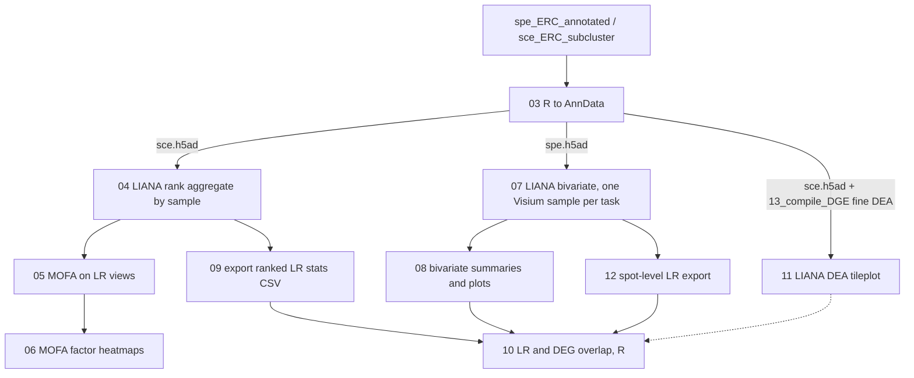

# 17_cell_cell_comm

Cell-cell communication (CCC) analysis of the ERC snRNA-seq and Visium (SpD-annotated) data. Ligand-receptor (LR) pairs are scored with [LIANA+](https://liana-py.readthedocs.io/) and, for Visium, with spatially aware bivariate statistics. The results are then linked to APOE carrier differential expression (DE) and to AD risk genes.

Scripts are numbered in run order. Most are Slurm jobs (`.sh` wrapper + `.py` or `.R` script) run on JHPCE. Paths are resolved from the repository root with `here::here()` (R) or `pyhere.here()` (Python), and the shell wrappers use `git rev-parse --show-toplevel`.

## Pipeline



Scripts `01` and `02` (CellNEST) form a separate branch. Nothing downstream in this folder reads their outputs.

## Scripts

| Script | Language / runner | What it does | Main inputs | Main outputs (under `processed-data/17_cell_cell_comm/` unless noted) |
|---|---|---|---|---|
| `01_preprocess.sh` | Bash, `cellnest preprocess`, array 1-31 | Builds CellNEST input graphs per Visium sample from Space Ranger outputs | `processed-data/01_spaceranger/<sample>/outs`, CellNEST database | `input_graph/<sample>/`, `metadata/<sample>/` |
| `02_run.sh` | Bash, `cellnest run`, GPU (`caracol`) | Trains CellNEST models with 80,000 epochs and fixed seeds | `input_graph/` | `model/`, `embedding_data/` |
| `03_r_to_anndata.R` / `.sh` | R via `zellkonverter`, array 1-2 | Converts SCE (task 1) and SPE (task 2) objects to AnnData. Keeps counts, logcounts, UMAP, and spatial coordinates | `processed-data/sce_objects/sce_ERC_subcluster`, `processed-data/spe_objects/spe_ERC_annotated` | `sce.h5ad`, `spe.h5ad` |
| `04_liana_mofa_run.py` / `.sh` | Python (LIANA+ 1.5.1), array 1-3 | Runs LIANA+ `rank_aggregate.by_sample` (consensus resource, 1000 permutations) on broad snRNA-seq (`cell_type_broad`), fine snRNA-seq (`cell_type_anno`), and Visium (`SpD`) groupings. Drops donor `Br1289` | `sce.h5ad`, `spe.h5ad` | `liana/ranked_adatas/{broad,fine,visium}.h5ad` |
| `05_liana_mofa_run.py` / `.sh` | Python, array (see note) | Builds LR-by-sample views and runs MOFA (10 factors) with `APOE_carrier`, `Ancestry`, `Sex`, and `Age` as covariates | `liana/ranked_adatas/*.h5ad` | `liana/mofa_results/model_*.h5ad`, `mdata_*.h5mu` |
| `06_liana_mofa_plot.py` / `.sh` | Python, array 1-3 | Adds a `taupathy` covariate and writes the ranked MOFA factor heatmaps | `liana/mofa_results/mdata_*.h5mu`, `00_project_prep/05_pathology/sample_taupathy.csv` | `plots/17_cell_cell_comm/liana/mofa_heatmap_*.pdf` |
| `07_liana_bivariate_run.py` / `.sh` | Python, array 1-30 (max 10 concurrent) | For each Visium donor: builds spatial neighbors (Gaussian kernel, bandwidth set from the spot size and 100 µm inter-spot distance), then runs LIANA+ bivariate cosine (local) and Moran's R (global) with 1000 permutations | `spe.h5ad`, `00_project_prep/02_get_online_metadata/metadata_visium_plan.csv`, Space Ranger `scalefactors_json.json` | `liana/bivariate_adatas/<BrNum>.h5ad` |
| `08_liana_bivariate_plot.py` / `.sh` | Python, single job | Writes a per-donor table of LR statistics, averages across donors, and plots the top LR pairs (spatial maps and domain boxplots) | `liana/bivariate_adatas/*.h5ad` | `liana/bivariate_stats.csv.gz`, `plots/.../liana/bivariate_{scores,p_vals,cats}.pdf`, `top_pairs_by_domain_*.pdf` |
| `09_liana_mofa_export_stats.py` / `.sh` | Python, array 1-3 | Exports the LIANA+ result table from each ranked AnnData to CSV | `liana/ranked_adatas/*.h5ad` | `liana/ranked_results/{broad,fine,visium}.csv.gz` |
| `10_LR_DEG_check.R` | R, interactive or `Rscript` with `-d` | Overlaps LR pairs with APOE carrier DEGs (`13_compile_DGE`), summarizes LIANA and bivariate results, and checks AD risk genes (OpenTargets). Writes tables and plots. Sources `code/13_compile_DGE/logFC_heatmap.R` | `13_compile_DGE/01_compile_DGE/<datatype>/DGE_results_carrier_<datatype>.Rds`, `liana/bivariate_stats*.csv.gz`, `liana/ranked_results/*.csv.gz`, color `.Rdata` files, `00_project_prep/07_OpenTargets_AD_data/clin_var_genes.csv` | `processed-data/17_cell_cell_comm/10_LR_DEG_check/`, `Liana_LR_DEGs_<datatype>.csv`; `plots/17_cell_cell_comm/10_LR_DEG_check/` |
| `11_liana_DEA.py` / `.sh` | Bash wrapper: R (convert `.Rds` to CSV), then Python (LIANA+ `df_to_lr`) | Joins fine snRNA-seq carrier DEA statistics (`vlmf_t`, `vlmf_adj.P.Val`) to LR interactions and plots the top 15 as a tileplot | `sce.h5ad`, `13_compile_DGE/.../sn_fine/DGE_results_carrier_sn_fine.Rds` | `13_compile_DGE/.../sn_fine/DGE_results_carrier_sn_fine.csv.gz` (conversion), `plots/.../liana/dea_tileplot_fine.pdf` |
| `12_liana_bivariate_export.py` / `.sh` | Python, single job | Exports spot-level LR scores from all bivariate AnnData files to one long CSV (one row per spot × pair) | `liana/bivariate_adatas/*.h5ad` | `liana/bivariate_stats_spot.csv.gz` |

Notes:

- Donor `Br1289` is dropped in every LIANA step. The script comments say its donor label is incorrect.
- Steps `04`, `07`, and `11` set the AnnData index to the `gene_name` column because LIANA+ needs gene symbols. The `sce` and `spe` objects must have this column.
- `08` and `12` are written as single jobs. `08` loads every bivariate AnnData file in memory.
- `08` applies a `min_num_donors = 20` filter to LR pairs after it writes `bivariate_stats.csv.gz`, so that CSV contains all pairs.

## Running

Submit the Slurm jobs in order from this folder, respecting the dependencies in the diagram. Logs go to `processed-data/17_cell_cell_comm/logs/`. The directory must exist before submission, because the `#SBATCH -o` paths point there.

```bash
cd code/17_cell_cell_comm
sbatch 01_preprocess.sh
sbatch 03_r_to_anndata.sh
sbatch 04_liana_mofa_run.sh
# after 04 finishes
sbatch 05_liana_mofa_run.sh
sbatch 09_liana_mofa_export_stats.sh
# ...
```

Required modules are loaded in each wrapper: `visium_hd/1.0` (CellNEST steps), `conda_R/4.5` (R steps), and `liana_plus/1.5.1` (Python steps).

Script `10_LR_DEG_check.R` has no wrapper. It reads the datatype from `-d` (`sn_broad`, `sn_fine`, or `Visium`), for example `Rscript 10_LR_DEG_check.R -d sn_fine`. It can also be run interactively after setting `opt$datatype`.

## Known issues to check before rerunning

- `02_run.sh` sets `--array=1`, but its script logic expects `NUM_RUNS_PER_SAMPLE=5` runs for each of 31 samples (array 1-155). Only task 1 runs as written.
- `05_liana_mofa_run.sh` sets `--array=2`, so only the fine snRNA-seq MOFA model is run by this wrapper. Broad and Visium need `--array=1-3` or separate submissions.
- `11_liana_DEA.py` covers only the fine snRNA-seq DEA. No broad or Visium version is included.

## Dependencies outside this folder

- `processed-data/sce_objects/sce_ERC_subcluster`, `processed-data/spe_objects/spe_ERC_annotated` (scripts 02_build_spe and 05_spe_correct_cluster)
- `processed-data/01_spaceranger/<sample>/outs` (`code/01_spaceranger`)
- `processed-data/13_compile_DGE/01_compile_DGE/` (`code/13_compile_DGE`)
- `processed-data/00_project_prep/` tables: `02_get_online_metadata/metadata_visium_plan.csv`, `05_pathology/sample_taupathy.csv`, `07_OpenTargets_AD_data/clin_var_genes.csv`, `cell_type_colors.V2.Rdata`
- `processed-data/project_colors.Rdata`, `processed-data/SpD_colors.Rdata`
- `code/13_compile_DGE/logFC_heatmap.R`, which `10_LR_DEG_check.R` sources

## Software

- CellNEST (via the `visium_hd/1.0` module): scripts 01-02
- LIANA+ 1.5.1, scanpy, MuData, muon, decoupler, plotnine, session_info (Python): scripts 04-09, 11-12
- zellkonverter, SingleCellExperiment, SpatialExperiment, basilisk, reticulate (R): script 03
- tidyverse, data.table, ComplexHeatmap, ggrepel, getopt, sessioninfo (R): script 10
