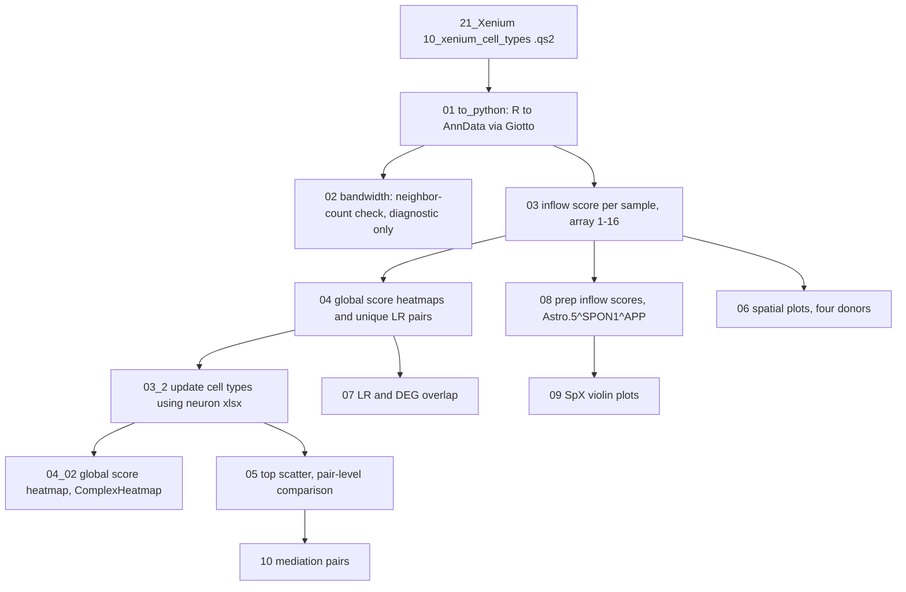

# 24_xenium_liana

Cell-cell communication (CCC) analysis of the Xenium ERC data with LIANA+. Each step scores ligand-receptor (LR) interactions in space and summarizes them by cell type, spatial domain (`SpX`), and APOE carrier status. Later steps compare the scores with Xenium and snRNA-seq DEGs and with mediation-style pairs.

The scripts are numbered in run order. Each numbered `.sh` file is a Slurm wrapper for the matching `.py` or `.R` file, submitted on JHPCE. Paths are resolved from the repository root with `here::here()` (R) or `pyhere.here()` (Python).

## Pipeline



## Scripts

| Script | Runner | What it does | Main inputs | Main outputs |
|---|---|---|---|---|
| `01_to_python.R` / `.sh` | R (`conda_R/4.5`) with Giotto | Converts the Xenium SPE to an AnnData file for Python. Keeps only `logcounts` | `processed-data/21_Xenium/10_xenium_cell_types/spe_xenium_cell_types.qs2` | `processed-data/24_xenium_liana/01_to_python/cell_rna_converted_gobject.h5ad` |
| `02_bandwidth.py` / `.sh` | Python (`liana_plus/1.7.1`) | Diagnostic only. Plots neighbor count against bandwidth for the first sample and shows the 42 µm kernel | `01_to_python` AnnData | `plots/24_xenium_liana/02_bandwidth/bandwidth_neighbors.pdf`, `spatial_kernel.pdf` |
| `03_inflow_score.py` / `.sh` | Python, array 1-16 | For each sample, builds spatial neighbors (42 µm bandwidth), runs LIANA+ `inflow` grouped by `cell_type_anno`, and computes global specificity | `01_to_python` AnnData | `processed-data/24_xenium_liana/03_inflow_score/lrdata_<sample>.h5ad` |
| `04_global_score_heatmap.py` / `.sh` | Python | Combines per-sample inflow results across donors, filters to LR pairs significant in at least `n_samples_sig = 3` donors, and writes summary tables. Plots source-by-target heatmaps, split by APOE carrier and as differences | `03_inflow_score/lrdata_*.h5ad` | `04_global_score_heatmap/global_interactions_summary.csv`, `global_interactions_unfiltered.csv`, `unique_ligand_receptor_pairs.csv`; plots in `plots/24_xenium_liana/04_global_score_heatmap/` |
| `03_2_update_cell_types.R` / `.sh` | R | Renames neuron cell types in the 04 summary tables to the updated names from the neuron xlsx. Writes new copies only | `04_global_score_heatmap/global_interactions_*.csv`, `04_snRNA-seq/27.5_sn_neuron_check/ERC_neuron_subcluster_details_annotated.xlsx` | `03_2_update_cell_types/global_interactions_summary.csv`, `global_interactions_unfiltered.csv` |
| `04_02_global_score_heatmap.R` / `.sh` | R (ComplexHeatmap) | Redraws the global score heatmaps with renamed cell types. Uses `n_samples_sig = 3` | `03_2_update_cell_types/global_interactions_unfiltered.csv`, color `.Rdata` | `plots/24_xenium_liana/04_02_global_score_heatmap/*_complexheatmap.pdf` |
| `05_top_scatter.R` / `.sh` | R | Compares the top LR pairs across APOE carrier groups and draws scatter plots with labels. Uses `n_samples_sig = 3` | `03_2_update_cell_types/` summary and unfiltered tables | `05_top_scatter/pair_level_comparison.csv`; plots in `plots/24_xenium_liana/05_top_scatter/` |
| `06_spatial_plots.py` / `.sh` | Python | For four donors, plots the inflow score for `Astro.5^SPON1^APP` and the expression of SPON1 and APP | `03_inflow_score/lrdata_<donor>.h5ad`, `01_to_python` AnnData | `plots/24_xenium_liana/06_spatial_plots/inflow_<donor>.pdf`, `LR_<donor>.pdf` |
| `07_DEG_overlap.R` / `.sh` | R | Joins the snRNA-seq DEG cluster with the lowest adjusted p-value to each LR gene. Stops if any LR gene is significant in the Xenium DEG results | `04_global_score_heatmap/unique_ligand_receptor_pairs.csv`, `13_compile_DGE/01_compile_DGE/Xenium/DGE_results_carrier_Xenium_wSN.csv` | `07_DEG_overlap/lr_deg_overlap.csv` |
| `08_prep_inflow.py` / `.sh` | Python | Pulls per-cell inflow scores for `Astro.5^SPON1^APP` from all samples into one table | `03_inflow_score/lrdata_*.h5ad` | `08_prep_inflow/inflow_scores.csv` |
| `09_SpD_violin.R` / `.sh` | R | Boxplots of inflow score by spatial domain (`SpX`), for all cell types and for `Oligo.3` | `08_prep_inflow/inflow_scores.csv`, `21_Xenium/13_xenium_bansky_embedding/spe_xenium_bansky.qs2` | `plots/24_xenium_liana/09_SpD_violin/SpD_boxplot_all_cell_types.pdf`, `SpD_boxplot_oligo_3.pdf` |
| `10_mediation_pairs.R` / `.sh` | R | Bar, scatter, and difference plots for selected pairs (astro FZD8, Oligo.3 ERBB3, APOE). Uses `n_samples_sig = 4` | `03_2_update_cell_types/global_interactions_unfiltered.csv`, `05_top_scatter/pair_level_comparison.csv` | `plots/24_xenium_liana/10_mediation_pairs/*.pdf` |

## Running

Submit the jobs from this folder in dependency order. Logs go to `processed-data/24_xenium_liana/logs/`, which must exist before submission.

```bash
cd code/24_xenium_liana
sbatch 01_to_python.sh
sbatch 03_inflow_score.sh          # array 1-16
sbatch 04_global_score_heatmap.sh
sbatch 03_2_update_cell_types.sh
sbatch 04_02_global_score_heatmap.sh
sbatch 05_top_scatter.sh
sbatch 10_mediation_pairs.sh
sbatch 08_prep_inflow.sh
sbatch 09_SpD_violin.sh
sbatch 06_spatial_plots.sh
sbatch 07_DEG_overlap.sh
```

Steps `02_bandwidth` is for checking only and is not needed downstream. Step `07` needs `13_compile_DGE` to have written the Xenium DEG file with the `wSN` suffix.

Required modules: `conda_R/4.5` (R steps) and `liana_plus/1.7.1` (Python steps).

## Known issues

- **Stale plots from step 04.** The `04_global_score_heatmap` PDFs in `plots/` are dated Jul 30 and use the old neuron names in `cell_type_levels` (for example `Excit.L2_5.1`). Step `03_2` renames only the processed CSV tables, not the plots. Rerun step 04 after the neuron update, and use the `04_02` plots for renamed labels.
- **Hard-coded Python path.** `01_to_python.R` points Giotto to a user-specific Conda environment (`/users/neagles/.conda/envs/giotto_env/bin/python`). Move this to a shared path or a configurable variable before others run it.
- **Hard-coded sample count.** `03_inflow_score.sh` uses `--array=1-16%16`. Confirm that the Xenium dataset has 16 samples. `06_spatial_plots.py` also hard-codes four donors.
- **Different `n_samples_sig` values.** Steps `04`, `04_02`, and `05` use 3. Step `10` uses 4. Confirm that this is intentional.
- **Fixed bandwidth.** Steps `02` and `03` both use 42 µm. Changing one requires changing the other.
- **Assertion in step 07.** The `stopifnot()` call will stop the script if any LR gene is significant in the Xenium DEG results.
- **Hard-coded interaction.** Steps `06`, `08`, and `09` focus on `Astro.5^SPON1^APP`. Changing the interaction means editing each script.

## Dependencies outside this folder

- `processed-data/21_Xenium/10_xenium_cell_types/spe_xenium_cell_types.qs2` (step 01)
- `processed-data/21_Xenium/13_xenium_bansky_embedding/spe_xenium_bansky.qs2` (step 09)
- `processed-data/04_snRNA-seq/27.5_sn_neuron_check/ERC_neuron_subcluster_details_annotated.xlsx` (step 03_2)
- `processed-data/13_compile_DGE/01_compile_DGE/Xenium/DGE_results_carrier_Xenium_wSN.csv` (step 07)
- `processed-data/00_project_prep/cell_type_colors.V2.Rdata` (steps 04_02, 05, 10)

## Software

- Giotto and SpatialExperiment (R): step 01
- LIANA+ 1.7.1, scanpy, anndata, plotnine (Python): steps 02-04, 06, 08
- tidyverse, ComplexHeatmap, circlize, ggrepel, readxl, qs2 (R): steps 03_2, 04_02, 05, 07, 09, 10
